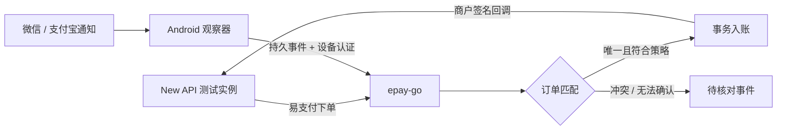

# EPay Observer Android

面向个人收款场景的 Android 微信／支付宝通知观察器，计划对接 [epay-go](https://github.com/HuangYincan/epay-go)，再通过易支付协议为 New API 自动充值。

**当前状态：规划仓库。没有 Android 工程、可安装 APK、到账采集实现或已通过的兼容性测试。** 文档中的接口、参数和技术选型除明确写为“现状”的内容外，均是待实现、待评审的规格，不能当成现成能力使用。

## 已确认的范围

- 微信和支付宝都要支持，分别采集样本、分别验收。
- 首个可用版本的目标是自动充值，不把人工确认当作最终主流程。
- 先用安卓模拟器开发和验证完整链路。
- 本仓库承载 APK 与协议规格；网关变更在 epay-go 中交付，通过跨仓库 Issue／PR 关联。
- 本轮只创建文档和 Issues，不开始功能开发。

模拟器第一阶段使用独立通知夹具 App 和隔离的测试网关／New API，不使用真实资金。**夹具通过只说明测试闭环通过，不证明真实微信、支付宝能被监听。** 通知也不等于平台验签的交易凭证，设备认证只认证上报者。

## 从这里开始

| 内容 | 入口 |
| --- | --- |
| 文档目录与阅读顺序 | [文档索引](docs/README.md) |
| 需求与验收目标 | [PRD](docs/product/PRD.md) |
| 总体架构与仓库分工 | [架构](docs/architecture/overview.md) |
| 分阶段计划 | [路线图](docs/ROADMAP.md) |
| 全部开发任务 | [Issue 索引](docs/issues/BACKLOG.md) |
| 第一阶段怎么验收 | [模拟器测试计划](docs/testing/emulator-plan.md) |
| 尚未决定的问题 | [待决问题](docs/OPEN-QUESTIONS.md) |

开发方式为 **Spec + Issue 驱动**：先定位需求与规格，再完成一个有独立验收标准的 Issue，最后提交关联 PR 和证据。详见 [贡献流程](CONTRIBUTING.md)。规格改动须与实现同步，Issue 不能仅因文档写完或代码编译通过就关闭。

## 本地目录与边界

约定本地路径：`/Users/acccan/Repos/huangyincan/epay-observer-android`。相关网关：相邻目录 `epay-go`。本仓库不复制网关源码，不包含用户收款码、通知原文、密钥、测试资金账号或 APK 签名私钥。

许可证尚未选择；公开仓库不代表已有开源授权。参考项目的许可证审计必须在复制任何实现前完成，见 [参考资料](docs/research/references.md)。
