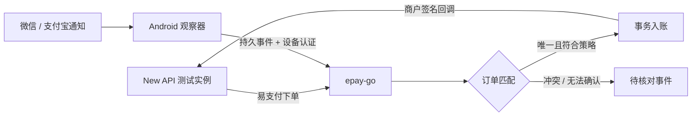

# EPay Observer Android

面向个人收款场景的 Android 微信／支付宝通知观察器，计划对接 [epay-go](https://github.com/HuangYincan/epay-go)，再通过易支付协议为 New API 自动充值。

**当前状态：首批 #9/#5 已建立 Android 工程和基础状态页，提供隔离测试 APK 与正式构建边界。** 当前尚无通知监听、到账采集、队列、上传或自动充值功能；后续协议和匹配规格仍是待实现方案。基础构建／模拟器验证不代表真实支付 App 兼容。

## 已确认的范围

- 微信和支付宝都要支持，分别采集样本、分别验收。
- 首个可用版本的目标是自动充值，不把人工确认当作最终主流程。
- 先用安卓模拟器开发和验证完整链路。
- 本仓库承载 APK 与协议规格；网关变更在 epay-go 中交付，通过跨仓库 Issue／PR 关联。
- M0 研究已交付；用户已批准首批 #9/#5 工程与已有 AVD 验证。后续通知与网关功能按各自 Issue 推进，不扩大当前授权。

模拟器第一阶段使用独立通知夹具 App 和隔离的测试网关／New API，不使用真实资金。**夹具通过只说明测试闭环通过，不证明真实微信、支付宝能被监听。** 通知也不等于平台验签的交易凭证，设备认证只认证上报者。

## 从这里开始

| 内容 | 入口 |
| --- | --- |
| 文档目录与阅读顺序 | [文档索引](docs/README.md) |
| 需求与验收目标 | [PRD](docs/product/PRD.md) |
| 总体架构与仓库分工 | [架构](docs/architecture/overview.md) |
| 分阶段计划 | [路线图](docs/ROADMAP.md) |
| 全部开发任务 | [Issue 索引](docs/issues/BACKLOG.md) |
| 第一阶段怎么验收 | [模拟器测试计划](docs/testing/emulator-plan.md) |
| 尚未决定的问题 | [待决问题](docs/OPEN-QUESTIONS.md) |
| M0 具体结论、证据与阻塞 | [M0 评审报告](docs/research/M0-review.md) |
| 构建、APK 检查和模拟器操作 | [开发指南](docs/development/build.md) |
| 首批 #9/#5 验证结果 | [工程基线报告](docs/testing/M1-foundation-report.md) |

开发方式为 **Spec + Issue 驱动**：先定位需求与规格，再完成一个有独立验收标准的 Issue，最后提交关联 PR 和证据。详见 [贡献流程](CONTRIBUTING.md)。规格改动须与实现同步，Issue 不能仅因文档写完或代码编译通过就关闭。

## 本地目录与边界

约定本地路径：`/Users/acccan/Repos/huangyincan/epay-observer-android`。相关网关：相邻目录 `epay-go`。本仓库不复制网关源码，不包含用户收款码、通知原文、密钥、测试资金账号或 APK 签名私钥。

本仓库采用 [MIT 许可证](LICENSE)，用户于 2026-10-15 确认。业务流程可以参考 vmqApk 及 V免签系列，旧代码仅供研究。旧 vmqApk 的 MIT 与内嵌 ZXing Apache-2.0 已分别检查，本轮未复制第三方实现；系列其他仓库仍需各自审计，见 [源码与许可证审计](docs/research/M0-source-audit.md)。真实通知尚不能安全证明订单归属；严格隔离的合成测试策略与生产准入门槛分开记录，不能把测试闭环当作真实自动收款可用。
